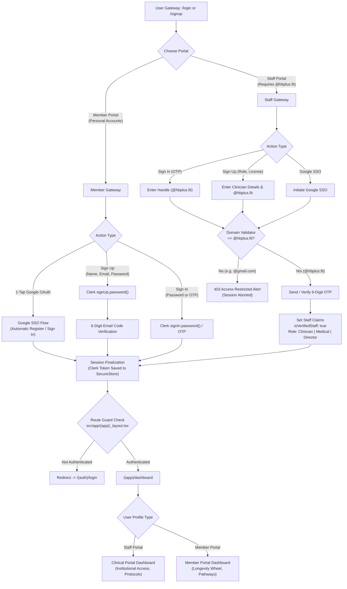

# HB+ Practitioner & Employee Portal

HB+ is a cross-platform clinical and employee portal built with **React Native**, **Expo (SDK 52)**, and **React Native for Web**. It delivers a high-performance, secure interface across Mobile (iOS/Android) and Web (Browser), featuring role-based dashboards, precision longevity pathways, and institutional access control.

---

## Table of Contents

- [Features](#features)
- [Tech Stack](#tech-stack)
- [Prerequisites](#prerequisites)
- [Setup Instructions](#setup-instructions)
- [Environment Variables](#environment-variables)
- [Authentication Flow](#authentication-flow)
- [How Domain Restriction Works](#how-domain-restriction-works)
- [Testing & Mocking](#testing--mocking)
- [Scripts & Commands](#scripts--commands)
- [Project Architecture](#project-architecture)

---

## Features

- **Dual-Portal Gateway**:
  - **Staff Portal (`@hbplus.fit`)**: Restricted clinical environment for Clinicians, Medical staff, and Directors with institutional biomarker analytics and patient protocol management.
  - **Member Portal (Personal Emails)**: Open member registration for precision longevity assessments, 3-Pillar Daily Wheel (Body, Mind, Gut), and care pathways.
- **Strict Domain Gatekeeper**: Instant rejection and session revocation for non-`@hbplus.fit` emails attempting institutional access.
- **Hardware-Backed Token Security**: Persistent JWT handling via `expo-secure-store` on native mobile and browser storage on web.
- **Universal Design System**: Tokenized styling via NativeWind v5 (Tailwind CSS v4) with an editorial palette: Terracotta (`#9F4022`), Warm Cream (`#FCF8F0`), and Charcoal (`#1A1918`).
- **File-Based Route Guards**: Layout-level route protection preventing unauthorized access and flashing states on `/dashboard`.

---

## Tech Stack

- **Framework**: [Expo](https://expo.dev) / React Native (Universal Web & Mobile)
- **Routing**: [Expo Router](https://docs.expo.dev/router/introduction/) (File-based navigation)
- **Authentication**: [Clerk Expo](https://clerk.com/docs/references/expo/overview) (`@clerk/expo`)
- **Database & Storage**: [Supabase](https://supabase.com) (`@supabase/supabase-js`)
- **Styling**: NativeWind v5 / Tailwind CSS v4
- **Icons & Typography**: Feather Icons, FontAwesome, Playfair Display, Plus Jakarta Sans, JetBrains Mono

---

## Prerequisites

Ensure you have the following installed on your system:

- [Node.js](https://nodejs.org) (v18.0.0 or later recommended)
- [npm](https://www.npmjs.com) or [yarn](https://yarnpkg.com)
- [Expo CLI](https://docs.expo.dev/get-started/installation/) (`npx expo`)
- A [Clerk](https://clerk.com) account (Development or Production instance)
- A [Supabase](https://supabase.com) project

---

## Setup Instructions

### 1. Clone & Install Dependencies

```bash
git clone <repository-url>
cd HbPlus

# Install packages with Expo-compatible versions
npx expo install
```

### 2. Configure Environment Variables

Create a `.env` file in the root directory by copying `.env.example`:

```bash
cp .env.example .env
```

Populate the required keys (see [Environment Variables](#environment-variables)).

### 3. Start the Development Server

```bash
# Universal interactive start (Press 'w' for web, 'a' for android, 'i' for iOS)
npx expo start

# Or launch directly in your default web browser
npx expo start --web
```

---

## Environment Variables

| Variable | Required | Description | Example |
|---|---|---|---|
| `EXPO_PUBLIC_CLERK_PUBLISHABLE_KEY` | **Yes** | Clerk publishable API key | `pk_test_...` |
| `EXPO_PUBLIC_SUPABASE_URL` | **Yes** | Supabase project URL | `https://xyz.supabase.co` |
| `EXPO_PUBLIC_SUPABASE_ANON_KEY` | **Yes** | Supabase anon public key | `eyJhbGci...` |
| `EXPO_PUBLIC_ALLOWED_DOMAIN` | Optional | Allowed institutional email domain (defaults to `hbplus.fit`) | `hbplus.fit` |

> [!NOTE]
> Never place private service keys (e.g. `CLERK_SECRET_KEY` or `SUPABASE_SERVICE_ROLE_KEY`) in client `.env` files. Variables prefixed with `EXPO_PUBLIC_` are bundled into client code.

---

## Authentication & Registration Flow

Authentication and user registration are orchestrated via `src/context/auth-context.tsx` and protected by layout route guards in `src/app/(app)/_layout.tsx`. Users can sign in or register through either traditional credentials (email/password/OTP) or Google OAuth / SSO.



```
                     ┌─────────────────────────────────────────┐
                     │    User Gateway: /login or /signup      │
                     └────────────────────┬────────────────────┘
                                          │
                  ┌───────────────────────┴───────────────────────┐
                  ▼                                               ▼
        [ Staff Portal ]                                [ Member Portal ]
       Strictly @hbplus.fit                            Personal Accounts (Gmail, Apple...)
                  │                                               │
   ┌──────────────┼──────────────┐                ┌───────────────┼───────────────┐
   ▼              ▼              ▼                ▼               ▼               ▼
Sign In        Sign Up      Google OAuth      Sign Up         Sign In        Google OAuth
 (OTP)      (Role/License)   (Staff SSO)    (Email/Pass)    (Pass or OTP)    (1-Tap Sign Up / In)
   │              │              │                │               │               │
   └──────────────┬──────────────┘                │               │               │
                  ▼                               │               │               │
       [ Domain Gatekeeper ]                      │               │               │
       isAllowedStaffDomain()                     │               │               │
         /              \                         │               │               │
   Valid Domain     Invalid Domain                │               │               │
  (@hbplus.fit)     (@gmail.com, etc.)            │               │               │
        │                  │                      │               │               │
        ▼                  ▼                      ▼               ▼               ▼
   6-Digit OTP       ❌ Blocked &           6-Digit OTP    Verify Pass       Instant
   Verification      Alert Raised           Verification     or OTP         Token Issued
        │                                         │               │               │
        └─────────────────┬───────────────────────┴───────────────┴───────────────┘
                          ▼
              ┌───────────────────────┐
              │ Session Finalization  │
              │  (Clerk Token Cache)  │
              └───────────┬───────────┘
                          ▼
              ┌───────────────────────┐
              │   Route Guard Check   │
              │ (src/app/(app)/_layout)│
              └───────────┬───────────┘
                          ▼
              ┌───────────────────────┐
              │    /(app)/dashboard   │
              │  (Staff vs Member UI) │
              └───────────────────────┘
```

### 1. Staff Authentication & Registration Flow
- **Registration**: Clinicians enter their Full Legal Name, `@hbplus.fit` email handle, select their institutional role (*Clinician*, *Medical*, or *Director*), and optional Medical License ID.
- **Sign In**: Staff can sign in via 6-digit email OTP dispatch or 1-tap Google SSO.
- **Domain Gatekeeper**: Both registration and sign-in strictly validate that the email ends with `@hbplus.fit`. Any attempt to use personal domains (e.g. `@gmail.com`) is rejected immediately with an inline error banner, preventing token creation.

### 2. Member Authentication & Registration Flow
- **Self-Registration via Email**: Members provide their Full Name, personal email, and password. A 6-digit OTP code is dispatched via Clerk to verify ownership before account creation is completed.
- **Self-Registration & Sign-In via Google OAuth**: Members can register and log in instantly with 1-tap Google OAuth (`signInWithGoogle('user')`). Clerk handles automatic user provisioning for new accounts and session restoration for existing ones without manual password management.
- **Passwordless Sign-In**: Existing members can sign in with their password or request a 6-digit OTP delivered directly to their email.

### 3. Route Guard & Protection
- Every route inside `src/app/(app)/` is governed by `_layout.tsx`.
- If an unauthenticated user attempts to enter `/dashboard`, the layout checks `isSignedIn && user`.
- Unauthenticated requests are immediately redirected:
  ```tsx
  if (!isSignedIn || !user) {
    return <Redirect href="/(auth)/login" />;
  }
  ```

---

## How Domain Restriction Works

Institutional data protection relies on a multi-layer verification strategy:

### Layer 1: Client-Side Input Validation
Located in `src/utils/domain-validator.ts`:
```typescript
const DEFAULT_ALLOWED_DOMAIN = process.env.EXPO_PUBLIC_ALLOWED_DOMAIN || 'hbplus.fit';

export function isAllowedStaffDomain(email: string, allowedDomain = DEFAULT_ALLOWED_DOMAIN): boolean {
  if (!email || !email.includes('@')) return false;
  const domain = email.split('@').pop()?.toLowerCase();
  return domain === allowedDomain.toLowerCase();
}
```
If a user tries to submit an invalid domain (e.g., `user@gmail.com`) through the staff entry point, the UI displays an explicit security error and aborts immediately.

### Layer 2: Auth Context Barrier
In `src/context/auth-context.tsx`, both `handleSignInWithPassword` and `handleSendSignInOtp` execute an explicit guard before touching the Clerk SDK:
```typescript
if (portalType === 'staff' && !isAllowedStaffDomain(cleanEmail)) {
  return {
    success: false,
    error: 'Access restricted. Please login using your official @hbplus.fit domain email.',
  };
}
```

### Layer 3: Role & Claim Mapping
The authenticated profile extracts claims from Clerk metadata:
```typescript
isVerifiedStaff: portalType === 'staff' && isAllowedStaffDomain(email);
```
The Staff Dashboard features a distinct gold institutional badge, clinical protocol assignment queues, and doctor status tags only when `isVerifiedStaff` resolves to `true`.

---

## Testing & Mocking

When testing without a live Google Workspace or MX configuration for `@hbplus.fit`:

### Option 1: Clerk Test Mode Subaddressing (Instant)
Clerk development instances (`pk_test_...`) automatically intercept emails containing `+clerk_test`:
1. In the **Staff Portal**, enter handle: `doctor+clerk_test` (resolved to `doctor+clerk_test@hbplus.fit`).
2. Click **Send Verification Code**. No live email is dispatched.
3. Enter universal test code: **`424242`**.
4. You will immediately access the **Clinical Portal**.

### Option 2: Pre-Verified User in Clerk Dashboard
1. Go to **Clerk Dashboard** → **Users** → **Create User**.
2. Email: `clinician@hbplus.fit` (Check *Mark email as verified*).
3. Set a password and assign public metadata:
   ```json
   {
     "portalType": "staff",
     "role": "Clinician"
   }
   ```
4. Sign in directly with email & password in the app.

### Option 3: Local Domain Override
Change the allowed domain in `.env` during development:
```env
EXPO_PUBLIC_ALLOWED_DOMAIN=gmail.com
```
Restart Metro (`npx expo start -c`) to test the real OTP email pipeline using your personal inbox as staff.

---

## Scripts & Commands

```bash
# Start development server
npx expo start

# Start directly in browser
npx expo start --web

# Typecheck TypeScript files
npx tsc --noEmit

# Run linter
npx expo lint

# Diagnose dependencies
npx expo-doctor

# Fix package compatibility
npx expo install --fix
```

---

## Project Architecture

```
HbPlus/
├── .agents/                  # AI agent skills & customization configurations
├── .md/                      # Architecture references & guides
├── assets/                   # Fonts, icons, and static images
├── src/
│   ├── app/                  # Expo Router file-based screens & layouts
│   │   ├── (app)/            # Protected layout & dashboard
│   │   │   ├── _layout.tsx   # Auth guard & redirect handler
│   │   │   └── dashboard.tsx # Dual Staff / Member dashboard
│   │   ├── (auth)/           # Authentication flows
│   │   │   ├── login.tsx     # Dual-portal sign-in (Staff OTP vs Member Pass/OTP)
│   │   │   ├── signup.tsx    # Dual-portal registration
│   │   │   └── verify.tsx    # 6-digit OTP verification screen
│   │   └── _layout.tsx       # Root provider layout
│   ├── components/ui/        # Design system UI primitives (Button, Card, Badge, etc.)
│   ├── context/
│   │   └── auth-context.tsx  # Clerk state, session methods, and user profile mapper
│   ├── services/
│   │   └── supabase.ts       # Supabase client instance
│   ├── theme/                # Design tokens (colors, typography, spacing, radius)
│   └── utils/
│       └── domain-validator.ts # Staff domain security gatekeeper
├── app.json                  # Expo application configuration
└── package.json              # Project dependencies and metadata
```
